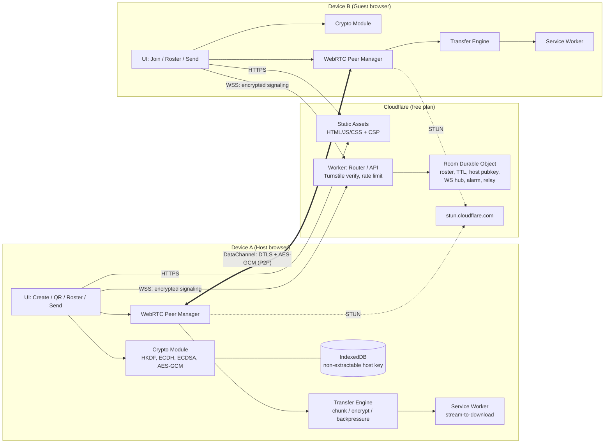
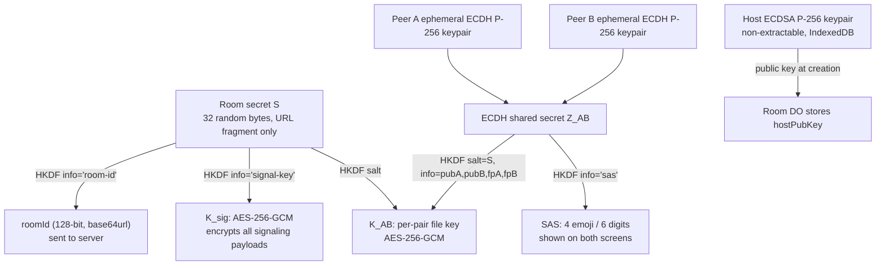
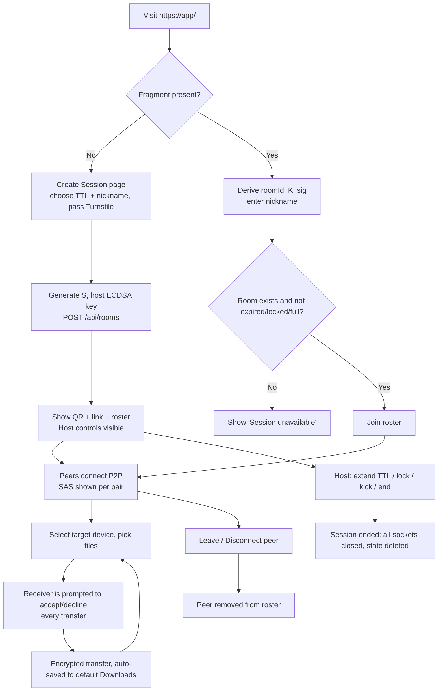
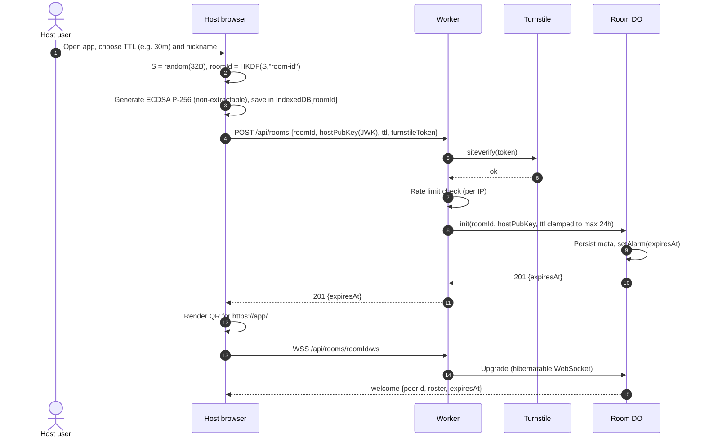
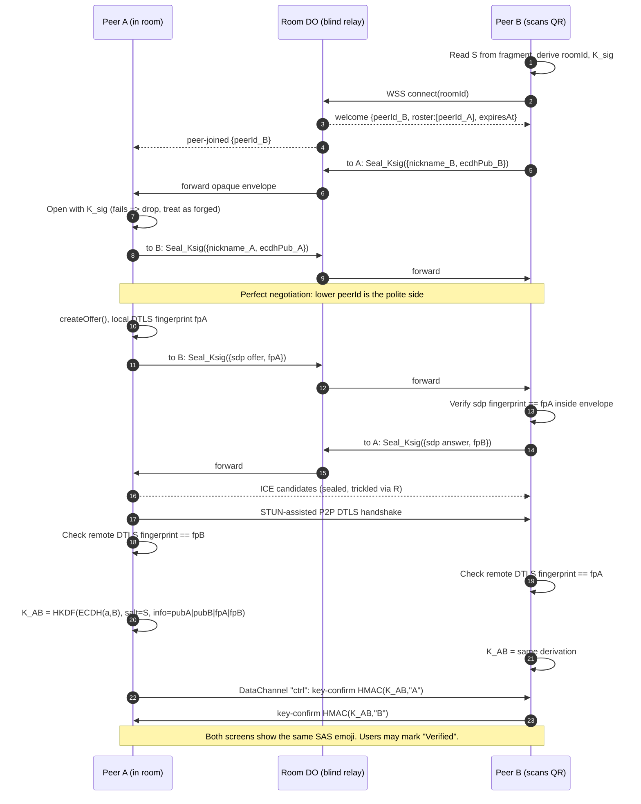
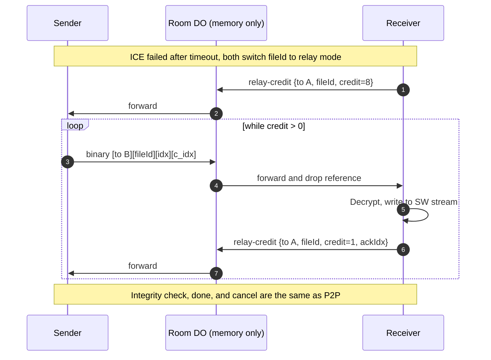
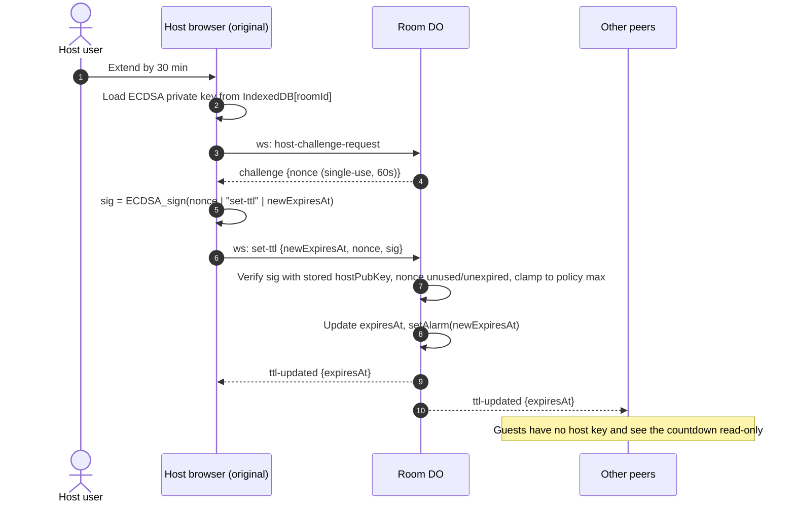
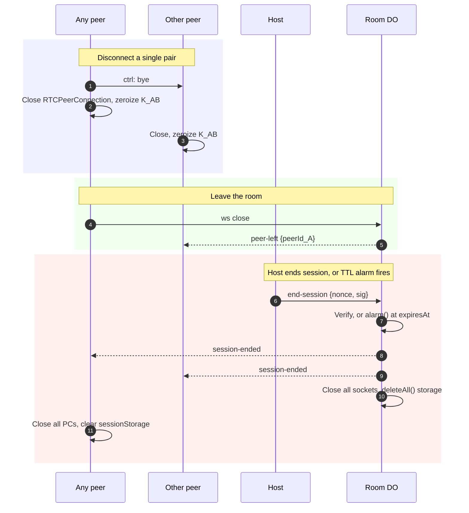
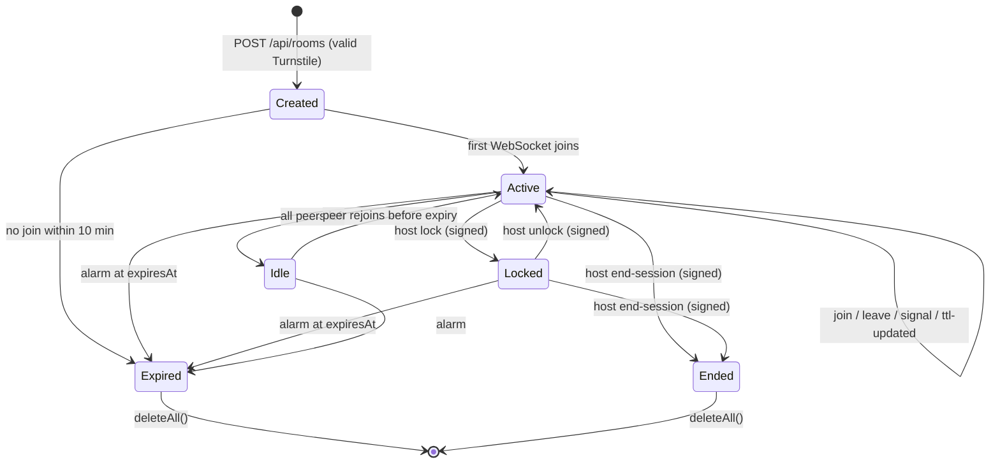
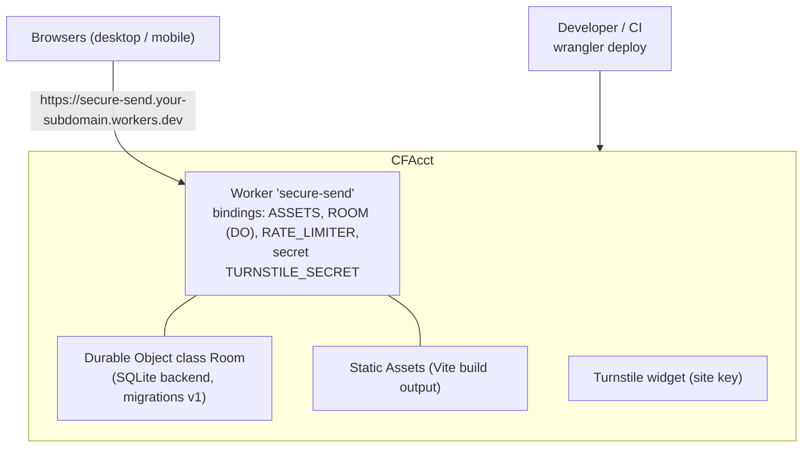

# Secure Send: Architecture and Plan

A browser-only, end-to-end encrypted file transfer service hosted on the Cloudflare free plan. Devices that hold the same secret room link can see each other by nickname and send files directly to one another. File contents are never stored on the server.

---

## 1. Requirements

| # | Requirement | How the design meets it |
|---|---|---|
| R1 | Secure channel between parties that have the URL and the correct secure ID | A 256-bit room secret is kept in the URL **fragment** (`#...`), which browsers never send to the server. Only holders of the secret can decrypt signaling or derive keys. |
| R2 | Deploy to Cloudflare (free) | A single Worker serves static assets and the API. One Durable Object (DO) per room handles signaling. STUN uses Cloudflare's free server. |
| R3 | Anyone visiting can create a session with a hard-to-guess ID | The browser generates the secret with `crypto.getRandomValues` (32 bytes, 43 base64url characters). Turnstile and rate limiting protect room creation. |
| R4 | QR code + URL to share | The QR code is rendered on the client from the full URL, including the fragment. |
| R5 | Peers see each other by nickname and pick a target device | The DO keeps a roster. Nicknames are encrypted with the room key, so the server sees only opaque peer IDs. |
| R6 | Encrypted transfer, no files left on the server | Files go over a WebRTC DataChannel (DTLS) with an extra application-layer AES-256-GCM layer. The fallback relay only forwards ciphertext held in memory; it never persists anything. |
| R7 | Prevent man-in-the-middle (MITM) attacks | Signaling is AEAD-encrypted with a key derived from the secret. The DTLS fingerprint is bound inside the encrypted signaling. ECDH identity keys are exchanged, and both sides can compare a Short Authentication String (SAS). |
| R8 | Creator sets the TTL; only the creating page can change or extend it | The host's ECDSA key is non-extractable and stored in IndexedDB on the creating browser. The DO verifies a signed challenge before applying any TTL change. A DO alarm enforces expiry. |
| R9 | Either side can terminate at any time | Any peer can close its own peer connection or leave the room. The host can destroy the room for everyone. |
| R10 | Files save to the browser's default download folder with no location prompt | Small files use a Blob URL with `<a download>`. Large files stream through a Service Worker as `Content-Disposition: attachment`. |

---

## 2. Technology choices

| Layer | Choice | Reason |
|---|---|---|
| Hosting | Cloudflare Workers with Static Assets | Free plan, one deployable unit, custom domain or `*.workers.dev` |
| Signaling state | Durable Objects (SQLite-backed, free plan) with the WebSocket Hibernation API | One strongly consistent object per room. Hibernation keeps the duration bill close to zero while idle. |
| Expiry | DO Alarms | Exact TTL enforcement with no cron job |
| Abuse control | Cloudflare Turnstile (free) and the Workers Rate Limiting binding | Prevents mass room creation |
| P2P transport | WebRTC `RTCDataChannel` | Direct device-to-device transfer; files bypass Cloudflare |
| NAT traversal | `stun:stun.cloudflare.com:3478` | Free |
| Fallback transport | Encrypted chunk relay through the room DO's WebSocket | Used when P2P fails (symmetric NAT). Ciphertext only, in memory only, no per-file size cap (credit-based flow control). |
| Optional TURN | Cloudflare Realtime TURN | Can be enabled later. Check current free-tier and pricing first. |
| Crypto | WebCrypto: HKDF-SHA-256, ECDH P-256, ECDSA P-256, AES-256-GCM | Native, audited, and available in both browsers and Workers |
| Frontend | TypeScript + Vite + Preact (small bundle), `qrcode-generator` | Small attack surface. No third-party runtime CDNs. |
| Large downloads | Service Worker stream (StreamSaver pattern) | Avoids holding multi-GB blobs in RAM |

---

## 3. Component architecture



### 3.1 Server components

| Component | Responsibility | Never sees |
|---|---|---|
| **Worker** | Serves assets with security headers. `POST /api/rooms` (create), `GET /api/rooms/:roomId/ws` (upgrade). Verifies Turnstile and rate limits. Routes to the DO by `idFromName(roomId)`. | Room secret, nicknames, file data |
| **Room DO** | Stores `{roomId, hostPubKey, expiresAt, maxPeers, locked}`. Holds the WebSocket set (hibernatable), assigns random `peerId`s, broadcasts join/leave, forwards opaque encrypted signaling envelopes, issues host challenges, runs the expiry alarm, and optionally relays encrypted chunks. | Room secret, plaintext SDP/ICE, nicknames, file data |

### 3.2 Client modules

| Module | Responsibility |
|---|---|
| **Session** | Parses the fragment, derives keys, opens the WebSocket, handles reconnects |
| **Crypto** | Key derivation, envelope seal/open, SAS computation, file-chunk AEAD |
| **Peer Manager** | One `RTCPeerConnection` per remote peer (mesh, capped at 4 peers per room). Uses perfect-negotiation pattern. |
| **Transfer Engine** | File offer/accept, 64 KiB chunks, `bufferedAmountLowThreshold` backpressure, per-file SHA-256 verification, progress, cancel |
| **Download Sink** | Blob + `<a download>` for files up to ~200 MB. Service Worker stream for larger files. |
| **Host Controls** | TTL picker, extend/shorten, lock room, kick peer, end session. Only shown when the host key exists in IndexedDB. |

---

## 4. Key and identity model



- **URL format:** `https://<app>/#<S_base64url>`. The path carries nothing secret. The server receives only `roomId = HKDF(S)` and cannot reverse it to get `S`.
- **Why the fragment:** browsers never send fragments in HTTP requests or `Referer` headers, and Cloudflare logs never contain them. The page also sets `Referrer-Policy: no-referrer`.
- **Guessing resistance:** both `S` (256 bits) and `roomId` (128 bits) are too large to enumerate. Unknown `roomId`s are rejected without revealing whether a room exists, and requests are rate limited.
- **Leak mitigation:** after the first load, the app moves `S` into `sessionStorage` and calls `history.replaceState` to strip the fragment from the address bar and history. The QR code and the copy-link button still produce the full URL.

---

## 5. MITM defense (defense in depth)

| Attacker | Attack | Defense |
|---|---|---|
| Network observer | Read or modify traffic | TLS to Cloudflare. DTLS 1.2+ on the DataChannel. AES-GCM application layer. |
| Malicious or compromised signaling server | Swap SDP or DTLS fingerprints to put itself between peers | All SDP/ICE/pubkeys are sealed with `K_sig`, which the server does not have. Tampering fails AEAD verification. The DTLS fingerprint is cryptographically bound into `K_AB` derivation. A fingerprint mismatch means decryption fails and the connection is aborted. |
| Server injects a fake peer | Appear in the roster as a device | A fake peer cannot produce a valid `K_sig` envelope, so clients drop it. |
| Someone else obtained the link | Joins as a third device | Host **lock room** and **max peers** settings. The join notification shows the new nickname, and the host can kick. Each pair shows a **SAS**. Users compare emoji in person or over the phone to confirm no relay attacker. The UI marks a peer as verified after confirmation. |
| Compromised JS delivery | Serve malicious code | Strict CSP (`default-src 'self'`, no inline script, `connect-src 'self' wss:`). No third-party scripts. SRI on all assets. Reproducible build. Optional: publish the bundle hash. |
| Replay of host commands | Re-send an old extend command | Server-issued single-use nonce, timestamp, and ECDSA signature |

> Residual risk: whoever holds `S` is trusted to join the room. Share the QR code or URL only over a channel you trust. SAS verification is what protects pairs from a relay attacker who has `S`.

---

## 6. Flows

### 6.1 Overall user flow



### 6.2 Session creation



### 6.3 Join and secure peer connection (MITM-resistant)



### 6.4 File transfer

```mermaid
sequenceDiagram
    autonumber
    actor UA as Sender
    participant A as Sender browser
    participant B as Receiver browser
    participant SW as Receiver Service Worker
    actor UB as Receiver

    UA->>A: Select target "B (Pixel 8)", choose files
    A->>B: ctrl: offer {fileId, Enc_KAB(name, size, mime), sha256}
    B->>UB: "A wants to send report.pdf (12 MB)" (shows SAS-verified badge)
    alt Receiver accepts
        UB->>B: Accept
        B->>A: ctrl: accept {fileId}
    else Receiver declines or prompt times out (60s)
        UB->>B: Decline
        B->>A: ctrl: decline {fileId}
        Note over A,B: Transfer ends here
    end
    B->>SW: Open stream /dl/fileId (attachment; filename)
    loop each 64 KiB chunk i
        A->>A: c_i = AES-GCM(K_AB, nonce=fileId|i, chunk_i, aad=fileId|i|last)
        A->>B: data channel: c_i (wait if bufferedAmount > high watermark)
        B->>B: Decrypt and verify tag (fail => abort)
        B->>SW: Enqueue plaintext
    end
    B->>B: Verify running SHA-256 == sha256
    B->>SW: Close stream, file lands in default Downloads
    B->>A: ctrl: done {fileId, ok}
    Note over A,B: Either side may send cancel {fileId} at any time
```

Each file in a multi-file selection gets its own offer and its own accept prompt. A batch offer can list several files in one prompt, but the receiver can still accept or decline each file individually.

### 6.4.1 Fallback relay (when ICE fails)

The same encrypted chunks (`c_i`, sealed with `K_AB`) travel over the existing WebSocket. The ECDH pubkeys are already exchanged over sealed signaling. The Room DO forwards each frame to the target socket and drops it immediately. Nothing is written to storage.

**No per-file size cap.** Unlimited size is safe because of three properties:

- **Credit-based flow control:** the receiver grants a window of N frames (default 8). The sender stops when credit runs out, and the receiver returns credit after it decrypts and writes each frame. This keeps the DO's in-flight memory bounded (about 8 MiB per transfer) no matter how large the file is, so the DO's 128 MB memory limit is never at risk.
- **Frame size close to 1 MiB** (960 KiB payload plus header). This minimizes the number of WebSocket messages, which is what the free-plan quota counts.
- **Quota exhaustion:** if the daily free quota is used up, Cloudflare rejects the request. The sender sees "Relay unavailable, try again later or switch network" and can retry after the quota resets. The transfer resumes from the last acknowledged chunk index.



### 6.5 Extend or change TTL (host-only)



The same challenge-signature mechanism protects other host actions: `lock`, `unlock`, `kick`, and `end-session`.

### 6.6 Termination



---

## 7. Room lifecycle (Durable Object state machine)



---

## 8. Deployment view



Example `wrangler.jsonc`:

```jsonc
{
  "name": "secure-send",
  "main": "src/worker/index.ts",
  "compatibility_date": "2026-11-01",
  "assets": { "directory": "./dist", "binding": "ASSETS", "not_found_handling": "single-page-application" },
  "durable_objects": { "bindings": [{ "name": "ROOM", "class_name": "Room" }] },
  "migrations": [{ "tag": "v1", "new_sqlite_classes": ["Room"] }],
  "ratelimits": [{ "name": "CREATE_LIMITER", "namespace_id": "1001", "simple": { "limit": 10, "period": 60 } }]
}
```

---

## 9. API and message protocol

### HTTP

| Method | Path | Body / Response |
|---|---|---|
| `POST` | `/api/rooms` | `{roomId, hostPubKey, ttlSec, turnstileToken}` returns `201 {expiresAt}`, `409` if the room exists, or `429` |
| `GET` | `/api/rooms/:roomId/ws` | WebSocket upgrade. Returns `404` (generic) if missing, expired, locked, or full. |

### WebSocket (JSON control and binary relay)

| Direction | Type | Payload (`sealed` = AES-GCM with `K_sig`, opaque to server) |
|---|---|---|
| S→C | `welcome` | `peerId, roster[peerId], expiresAt, isLocked` |
| S→C | `peer-joined` / `peer-left` | `peerId` |
| C→S→C | `signal` | `to, from, sealed{kind: hello\|offer\|answer\|ice\|bye, ...}` |
| C↔S | `host-challenge` / `challenge` | `nonce` |
| C→S | `set-ttl` / `lock` / `unlock` / `kick` / `end-session` | `args, nonce, sig` |
| S→C | `ttl-updated` / `session-ended` / `kicked` | `expiresAt` / `reason` |
| C→S→C | binary `relay` | `[to(16B)][fileId(16B)][idx(4B)][ciphertext]` |
| C→S→C | `relay-credit` | `to, fileId, credit, ackIdx` |

### DataChannel (`ctrl` reliable/ordered, `data` reliable/ordered, binary)

`key-confirm`, `offer`, `accept`, `decline`, `cancel`, `done`, `bye`, and binary chunk frames `[fileId(16B)][idx(4B)][flags(1B)][ciphertext+tag]`.

---

## 10. Security controls checklist

- **Input validation:** the Worker and DO enforce a JSON schema, size limits (signal at most 16 KB, relay frame at most 1 MiB), and a `roomId` regex. Unknown message types are rejected.
- **Host-only actions:** ECDSA signature, single-use nonce, 60 s expiry, and constant-time comparison.
- **TTL policy:** minimum 5 min, maximum 24 h total, enforced on the server. The DO alarm is authoritative, and the client countdown is informational only.
- **Headers:** `Content-Security-Policy`, `Strict-Transport-Security`, `Referrer-Policy: no-referrer`, `X-Content-Type-Options: nosniff`, `Permissions-Policy` (camera allowed only for the optional QR scanner), and `Cross-Origin-Opener-Policy: same-origin`.
- **Filename safety:** strip path separators and control characters, cap length, and never render filenames as HTML (`textContent` only).
- **No logging** of payloads. Worker logs record only status codes and hashed `roomId`.
- **Memory hygiene:** drop key references on termination and revoke Blob URLs after download.
- **Abuse:** Turnstile on create, rate limiting per IP, and `maxPeers = 4` enforced by the DO. A 5th WebSocket gets a generic `404`.
- **Consent:** every incoming file needs an explicit receiver accept. There is no auto-accept. Unanswered offers expire after 60 s.

---

## 11. Browser behavior notes (R10)

- `<a download>` and Service Worker attachment responses save to the browser's **default download folder** with no file-picker. The exception is when the user has turned on "Always ask where to save" in browser settings. The app cannot override that setting and should say so in the UI.
- Chrome may ask once to allow "multiple automatic downloads" from the site. The UI should tell the user to allow it.
- iOS Safari: Blob downloads open a preview or share sheet, so iOS gets a documented degraded path ("Save to Files"). The Service Worker streaming path is not reliable on iOS.
- The File System Access API (`showSaveFilePicker`) is intentionally **not** used because it always prompts for a location.

---

## 12. Free-plan constraints (check current limits before launch)

| Resource | Impact | Mitigation |
|---|---|---|
| Worker requests per day | Every page load and WS upgrade counts | Static assets are served by the Assets binding |
| DO requests and duration per day | WS messages count as requests | Hibernation API, batched ICE candidates, P2P-first so file bytes skip the DO |
| WS message size (1 MiB) | Relay frame size | 960 KiB relay payload per frame |
| CPU per invocation | Signature verification and routing are cheap | No crypto on file data server-side |
| No free TURN guaranteed | Some NATs block P2P | DO relay fallback (uncapped size, quota-bounded), with optional Cloudflare Realtime TURN later |
| Daily relay volume | The free daily request quota is the only practical ceiling on relay bytes | Use P2P first. Show a clear error and allow resume when the quota is exhausted. If this happens regularly, consider Workers Paid ($5/mo) or TURN. |

---

## 13. Project structure (proposed)

```
secure-send/
├─ ARCHITECTURE.md
├─ wrangler.jsonc
├─ package.json
├─ src/
│  ├─ worker/
│  │  ├─ index.ts          # router, headers, Turnstile, rate limit
│  │  ├─ room.ts           # Room Durable Object
│  │  └─ protocol.ts       # shared message schemas (zod/valibot)
│  └─ client/
│     ├─ main.tsx
│     ├─ session.ts        # fragment parse, WS, reconnect
│     ├─ crypto.ts         # HKDF/ECDH/ECDSA/AES-GCM/SAS
│     ├─ peers.ts          # RTCPeerConnection mesh
│     ├─ transfer.ts       # chunking, backpressure, integrity
│     ├─ download-sw.ts    # service worker streaming sink
│     └─ ui/               # Create, Room, Roster, HostControls, QR
└─ test/
   ├─ unit/                # crypto vectors, protocol schema
   ├─ worker/              # vitest + @cloudflare/vitest-pool-workers
   └─ e2e/                 # Playwright, two browser contexts
```

---

## 14. Implementation plan

| Phase | Deliverables | Exit criteria |
|---|---|---|
| **0. Scaffold** | Vite + Worker + DO skeleton, `wrangler dev`, CI lint/test, security headers | `wrangler deploy` serves a hello page with CSP at an A grade |
| **1. Rooms and signaling** | Create API with Turnstile and rate limiting, Room DO (hibernatable WS, roster, alarm), fragment-derived `roomId`, QR code | Two tabs see each other's peer IDs. Room expires on time. |
| **2. Crypto layer** | `K_sig` envelopes, nickname exchange, ECDH, SAS, host ECDSA key in IndexedDB | Server-side tamper test: a modified envelope is rejected. SAS matches across devices. |
| **3. P2P connection** | Perfect-negotiation mesh, DTLS fingerprint binding, key-confirm | Two devices on different networks connect. A fingerprint mismatch aborts. |
| **4. File transfer** | Offer/accept, chunked AES-GCM, backpressure, SHA-256 verify, cancel, progress, multi-file | 2 GB file transfers desktop-to-desktop with flat memory. Tampered chunk aborts. |
| **5. Download sink** | Blob path, Service Worker streaming path, filename sanitization, per-transfer accept prompt with 60 s timeout | Files land in default Downloads with no prompt on Chrome, Edge, Firefox, and Android Chrome |
| **6. Host controls and termination** | Signed set-ttl/lock/kick/end, countdown UI, per-pair disconnect, leave | A guest cannot extend (signature rejected). Host on a reopened original tab can extend. |
| **7. Relay fallback** | DO binary relay with credit-based flow control, resume from last acked chunk, quota-exhausted handling | P2P blocked in test (ICE policy) and a 2 GB transfer still succeeds through the relay with bounded DO memory. Nothing is persisted. |
| **8. Hardening and launch** | Threat-model review, dependency audit, Playwright E2E, rate-limit tuning, privacy page | All tests green and production deploy done |

---

## 15. Decisions

| # | Topic | Decision |
|---|---|---|
| D1 | Room size | Up to **4 devices** per session (full mesh, at most 6 peer connections). Any device can send to any other. |
| D2 | Accepting files | The receiver is **prompted to approve every transfer**. No auto-accept. |
| D3 | Fallback relay | **Enabled, no per-file size cap.** Bounded by credit-based flow control. The free daily quota is the only ceiling, and transfers resume once it resets. |
| D4 | Max TTL | **24 h** total, minimum 5 min. Only the host can extend. |
| D5 | TURN | Deferred. Decide after measuring the P2P failure rate in real use. |

---

## 16. Implementation status and local development notes

Status of the MVP relative to the plan above:

| Area | Status |
|---|---|
| Phases 0-6 (rooms, signaling crypto, P2P mesh, chunked AES-GCM transfer, download sinks, host controls) | Implemented |
| Phase 7 (Durable Object relay fallback, resume) | **Not implemented.** Transfers need a working WebRTC DataChannel. |
| Whole-file SHA-256 | Not implemented. Chunks are authenticated individually (AAD = fileId + index + final flag). |
| Playwright E2E in the repo | Not added. Flows were verified manually with two headless Chrome contexts. |

Behavior added after the first draft:

- **Dev mode.** `DEV_MODE=1` (set by `local.ps1` / `local.sh`) skips Turnstile, the rate limiter and the `CF-Connecting-IP` requirement; `/api/config` returns `devMode` and the UI hides the Turnstile widget. Never enable it in production.
- **LAN testing.** `-Lan` / `--lan` runs wrangler on `0.0.0.0` with a self-signed HTTPS certificate. HTTPS is required because WebCrypto needs a secure context off localhost.
- **Random nickname.** Each visitor gets a default "Adjective Animal" nickname that can be edited.
- **Auto-rejoin.** When the socket closes, or the page returns to the foreground (`visibilitychange` / `pageshow`) with a dead socket or disconnected peer, the client re-enters the room (up to 6 attempts) using the secret kept in sessionStorage. This covers iOS suspending a backgrounded tab. In-progress transfers are cancelled, and a locked room refuses reconnects. Leaving on purpose, being kicked, or the session ending clears the rejoin state.
- **Sender look-ahead.** The sender reads one chunk ahead so the `final` flag reflects the bytes actually read.
- **Download sinks.** Service-worker streaming is used where available. If registration fails (for example on a self-signed certificate) it falls back to a Blob. On iOS the file is buffered in memory (200 MB cap) and a "Ready to save" card with a Save button uses `navigator.share({files})` or an anchor download, since iOS needs a user gesture.
- **WebSocket upgrade.** `withSecurityHeaders` returns 101 responses unchanged so the `webSocket` is not dropped.
- **Key derivation.** `deriveRoomKeys` copies the room secret, so callers can safely zero their copy.
