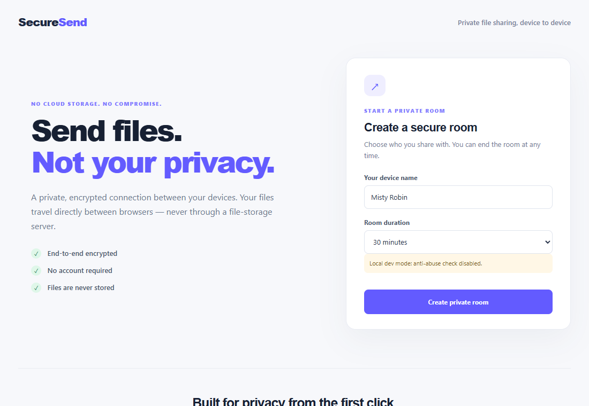
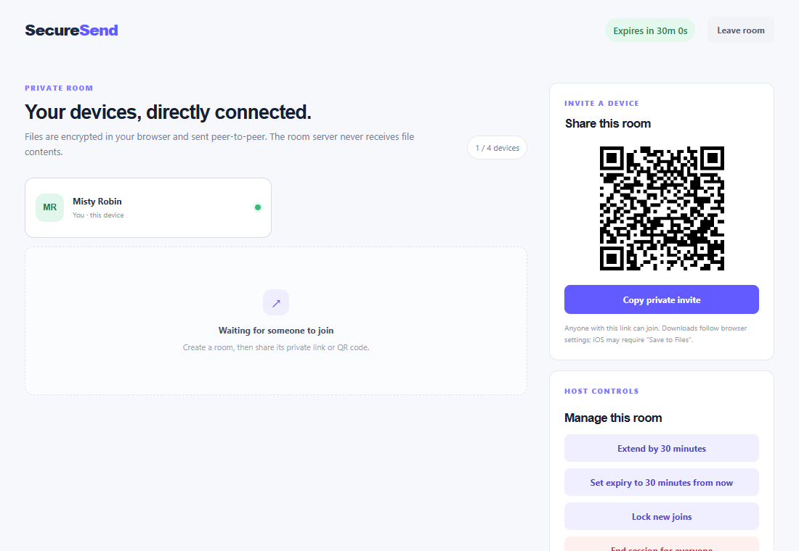
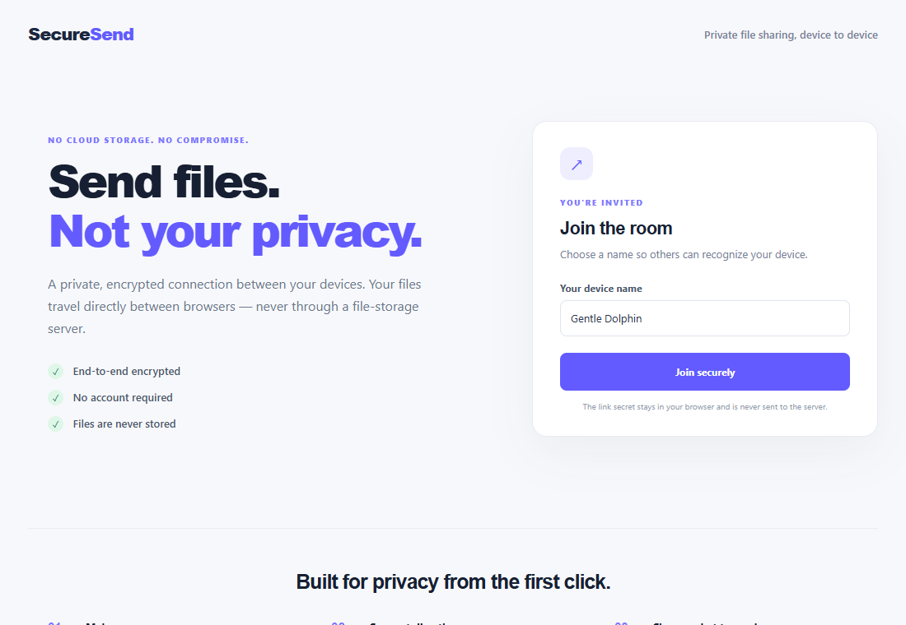
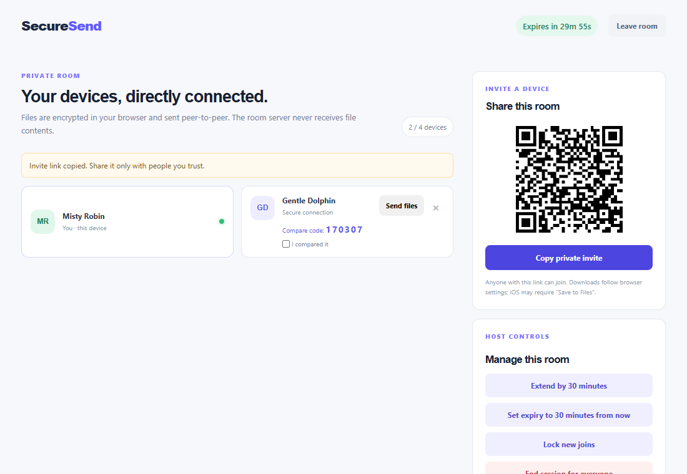

# Secure Send

Secure Send creates short-lived rooms for browser-to-browser file transfers. Room secrets stay in the URL fragment and browser session storage. Signaling is AES-GCM encrypted, peers derive file keys with ECDH, and file bytes travel over WebRTC DataChannels. The server stores room metadata only.

## Screenshots

| Create a room | Host view with invite QR |
|---|---|
|  |  |

| Join from an invite link | Two devices connected |
|---|---|
|  |  |

## Local development

Requirements: Node.js 20.19+. Run `npm install` once.

### Quick start (no Cloudflare account or Turnstile needed)

One script builds and runs the app in local dev mode. Dev mode (`DEV_MODE=1`) skips Turnstile and rate limiting, and must never be used in production.

| | Windows (PowerShell) | macOS / Linux / WSL |
|---|---|---|
| Start | `.\local.ps1 start` | `./local.sh start` |
| Stop | `.\local.ps1 stop` | `./local.sh stop` |
| Restart / status | `.\local.ps1 restart` / `status` | `./local.sh restart` / `status` |
| LAN mode | add `-Lan` | add `--lan` |

- Default: http://localhost:8787.
- LAN mode serves **HTTPS** on all interfaces (for example `https://10.0.0.105:8787`) so phones can connect. Accept the self-signed certificate warning once. HTTPS is required because WebCrypto only works in a secure context off localhost. Switching modes needs `restart`, because both use port 8787.
- If Windows Firewall blocks the phone, allow Node.js on your network profile.
- On WSL/Linux the script runs `npm install` natively when the platform `workerd` package is missing (for example when `node_modules` came from Windows).
- State and logs: `.local-server.pid`, `.local-server.log`, `.local-server.log.err` (git-ignored).

### Manual setup with Turnstile

1. Add your Turnstile site key to `TURNSTILE_SITE_KEY` in `wrangler.jsonc`.
2. Put `TURNSTILE_SECRET=...` in `.dev.vars` (a Turnstile test key works locally). For deployment use `npx wrangler secret put TURNSTILE_SECRET`.
3. `npm run build`, then `npx wrangler dev`. Optionally run `npm run dev` for Vite, which proxies `/api` and WebSockets to port 8787.

`npm run test` runs the cryptography unit tests, `npm run build` type-checks and builds, and `npm run deploy` builds and deploys to Cloudflare.

## Deployment

Set `TURNSTILE_SITE_KEY` in `wrangler.jsonc`, save `TURNSTILE_SECRET` as a Worker secret, then run `npm run deploy`. Use HTTPS in production; browser crypto, WebRTC, service-worker downloads, and clipboard access depend on a secure context.

## Current implementation scope

This version includes room creation/joining, opaque room IDs, encrypted signaling, a Durable Object roster and expiry alarm, host-signed TTL/lock/kick/end actions, WebRTC peer connections, manual SAS comparison, per-file receiver approval, chunked AES-GCM transfers, and streamed downloads where service workers are supported.

The WebSocket file-relay fallback and resume-after-disconnect are not implemented yet; transfers currently require a working WebRTC DataChannel. The service-worker path streams large downloads without holding the whole file in memory. Browsers without that path use a Blob fallback capped at 200 MiB. On iOS the file is buffered in memory and a "Ready to save" card with a Save button (share sheet) appears. Files are authenticated chunk-by-chunk with AES-GCM; there is no separate whole-file SHA-256 pass.

Configure a real Turnstile site key and secret before exposing room creation publicly. Room creation deliberately fails closed when Turnstile or the rate-limit binding is unavailable.

## Mobile and reconnection behavior

Each device gets a random "Adjective Animal" nickname that you can change. If a phone switches apps and the connection drops, the client automatically rejoins the room when it returns (transfers in progress are cancelled, and a locked room refuses rejoin). See `ARCHITECTURE.md` section 16 for details.

## Live deployment

Deployed at [deployment URL omitted] (Turnstile site key is set in `wrangler.jsonc`; the secret is stored as a Worker secret).
